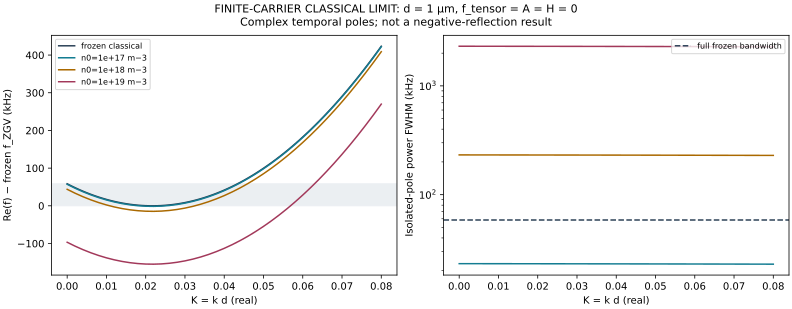
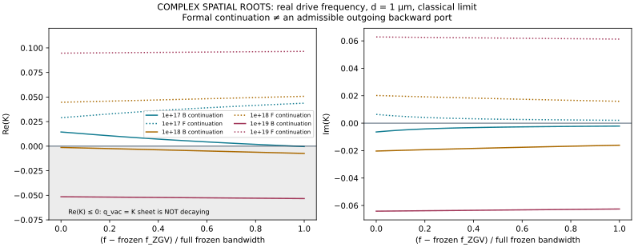
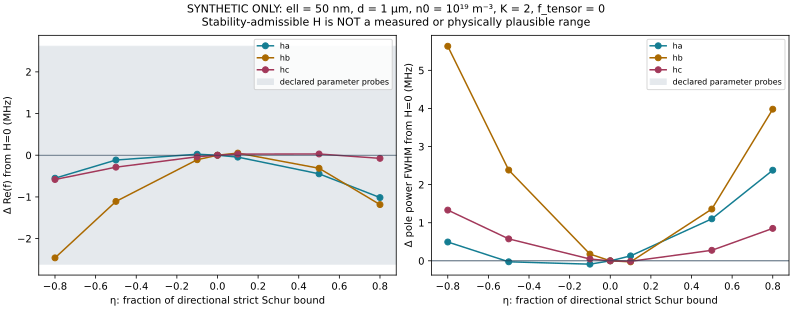

# PAPER A — A0-R backward-wave feasibility correction

**Date:** 2026-11-05. **Decision: REVISE.**

**Scope:** the reported longitudinal-thickness family in the retained ZnO plate; finite carrier drift–diffusion, complex temporal **and** spatial roots, a bounded nine-scenario check, and symmetry-/stability-constrained synthetic H sensitivity. No edge scattering, geometry change or manuscript.

> **Evidence boundary:** all sourced-constant propagation results below are the **classical limiting model** \(f=A=H=0\), now with finite-rate carriers. Nonzero A/H results are explicitly **synthetic**, at \(f=0\). No calibrated nonzero flexoelectric/gradient/H material set is available. Therefore these calculations do **not** establish the prescribed full flexoelectric model's physical feasibility or genuine negative reflection.

## 1. Material, boundaries and small study

The classical constants remain those transcribed from **Zhang et al., Table 1**, DOI [10.1007/s10483-025-3272-7](https://doi.org/10.1007/s10483-025-3272-7), [full article](https://www.amm.shu.edu.cn/article/2025/0253-4827/0253-4827-2025-07-1331.shtml#T1):

- \((c_{11},c_{12},c_{13},c_{33},c_{44},c_{66})=(210,121,105,221,43.0,44.5)\) GPa;
- \((e_{15},e_{31},e_{33})=(-0.48,-0.57,1.32)\) C m\(^{-2}\);
- \((\kappa_{11},\kappa_{33})=(7.61,8.85)\times10^{-11}\) F m\(^{-1}\), **absolute** permittivities;
- \(\rho=5700\) kg m\(^{-3}\), \(M=0.0100\) m\(^2\) V\(^{-1}\) s\(^{-1}\), \(D_n=2.60\times10^{-4}\) m\(^2\) s\(^{-1}\).

Table 1 attributes the constants to Yang (2020), its reference 11; the underlying measurements/book were not independently retrieved. Complete provenance and universal constants are retained in [`a0/materials.json`](a0/materials.json) and the [A0 materials audit](PAPER_A_A0_MATERIALS.md). The tabulated Einstein ratio gives \(k_BT=qD_n/M\), hence an effective \(T=301.717\) K. This is a consistent interpretation of rounded transport data, **not a measured sample temperature**.

The c-axis is normal to the plate; total thickness is d. Faces are mechanically free, carrier-blocking, and coupled to the **exact quasistatic vacuum exterior**. No simultaneous concentration-zero condition is imposed. At nonzero A the retained traction and double-traction conditions apply. Zhang's local \(D_3=0\) boundary model is **not substituted** for this vacuum problem. A0 already showed that this distinction matters to the narrow feature.

Only these nine **design scenarios**, not measured/verified-achievable ZnO samples, are used:

\[
d\in\{0.5,1,3\}\ \mu\mathrm m,\qquad
n_0\in\{10^{17},10^{18},10^{19}\}\ \mathrm m^{-3}.
\]

The original 1 μm case is retained; 0.5 μm provides a smaller micron-scale comparison and 3 μm is Zhang's Section 4 example thickness. The source-used \(10^{19}\) concentration anchors two lower decades as a finite **carrier-loss bracket**, not an optimization or a claim about attainable doping. Source constants/transport are held fixed; their applicability across the resulting GHz frequencies remains a modeling assumption. No further **design** thickness/carrier range was searched. The separate dilute-density recovery check is a mandatory mathematical limit test, not an additional candidate scenario.

We keep the **original** dimensionless operating frequency, rather than retuning it to make a case succeed:

\[
K=kd,\quad \Omega=\omega d/c_s,\quad c_s=\sqrt{c_{44}/\rho}=2746.6088\ \mathrm{m/s},
\quad\Omega_*=7.4325439492.
\]

Thus the physical comparison frequencies are 6.498070, 3.249035 and 1.083012 GHz for the three thicknesses, **not a fixed-frequency thickness sweep**. Numerical reference digits below are reproducibility digits, not measurement accuracy.

## 2. Independent correction of the “35 kHz window”

The historical 34.622 kHz result is recovered, but it covered only the checked segment **\(K\ge0.005\)**. It was not the full \(K\to0\)-to-ZGV interval.

At \(K\to0^+\), classical open-circuit thickness extension has \(D_3=0\), giving

\[
\Omega_0=\pi\sqrt{\frac{c_{33}+e_{33}^{2}/\kappa_{33}}{c_{44}}}
=7.4326380843.
\]

A separate parity-restricted Galerkin solve **at K=0** agrees with this analytic result to \(1.27\times10^{-13}\) in Ω, without passing K=0 through the old singular-gauge implementation. An independently assembled six-state thickness propagator also checks finite-K frequencies, including \(K=10^{-4}\), the original pair, and ZGV.

| Classical, frozen, exact-quasistatic-vacuum quantity, d = 1 μm | Corrected result |
|---|---:|
| One-sided K→0 cutoff frequency | 3.249076357 GHz |
| ZGV wavenumber \(K_{\rm ZGV}\) | 0.02169259 |
| ZGV frequency | 3.249017896 GHz |
| **Full one-sided model bandwidth** \(f_0-f_{\rm ZGV}\) | **58.46 kHz** |
| Historical checked bandwidth, K≥0.005 | **34.62 kHz** |
| Retained original target frequency | 3.249035207 GHz |
| Frozen same-frequency pair \((K_b,K_f)\) | (0.00989002, 0.03349084) |

The target lies about 29.6% of the way up the **full** frozen interval; it was the midpoint of the earlier restricted interval. The full-width correction does not establish a usable finite-carrier branch. Both K=0 and ZGV are limiting endpoints, not ordinary finite-energy-transport ports. This is the retained **quasistatic model's** cutoff limit, not a full-Maxwell/radiative calculation.

Data: [`full_classical_window.csv`](a0r/results/full_classical_window.csv).

## 3. Complex dispersion and correct loss definitions

Use \(e^{ikx-i\omega t}\).

### 3.1 Temporal pole at real k

For \(\omega=\omega_r-i\gamma\), \(\gamma>0\):

\[
\tau_A=\gamma^{-1},\qquad \tau_E=(2\gamma)^{-1}.
\]

For an **isolated modal Lorentzian at fixed real k**, the pole-derived power-spectrum widths are

\[
\mathrm{HWHM}_f=\frac{\gamma}{2\pi},\qquad
\mathrm{FWHM}_f=\frac{\gamma}{\pi}.
\]

A driven device can have additional excitation/interference effects; no driven spectrum was calculated. In particular, **\(-\operatorname{Im}\omega/(2\pi)\) is not the power FWHM, a spatial attenuation coefficient, or a propagation length.**

At the original d = 1 μm, \(n_0=10^{19}\), \(K_b=0.00989002\):

\[
\Omega=7.4321892698-0.00264614666i.
\]

| Temporal result | Value |
|---|---:|
| Re(f) | 3.248880164 GHz |
| Shift from frozen original target | −155.04 kHz |
| Amplitude decay rate γ | \(7.26793\times10^6\) s\(^{-1}\) |
| Amplitude 1/e lifetime | 137.59 ns |
| Energy 1/e lifetime | 68.80 ns |
| Pole-derived power HWHM | 1.15673 MHz |
| **Pole-derived power FWHM** | **2.31345 MHz** |
| FWHM / **full** 58.46 kHz frozen interval | **39.6** |

The earlier 1.1567 MHz number is reproduced, with its meaning corrected. Small loss relative to a 3.249 GHz carrier frequency is **not** small loss relative to a 58 kHz backward feature. The linewidth/window ratio alone is not an existence test: complex-k decay and energy flux below determine which continued roots are admissible.

### 3.2 Spatial root at real ω

For \(k=\beta+i\kappa\), the amplitude and energy/power envelopes along the energy-propagation direction have

\[
\alpha_A=|\kappa|,\quad L_A=|\kappa|^{-1},\quad
L_E=(2|\kappa|)^{-1},\quad
\frac{P(L)}{P(0)}=e^{-2|\kappa|L}.
\]

These quantities are obtained by solving **complex k at real ω**, not by assigning a temporal linewidth a length. The approximation \(\kappa\simeq\gamma/v_g\) requires a weak-loss, nonstationary branch and is unreliable near ZGV.

For a positive-phase backward port directed toward −x, require **all** of

\[
\beta>0,\quad P_x<0,\quad\kappa<0,
\]

plus decaying exterior fields and the governing/face residual checks. The exterior exponent is \(\chi=\sqrt{k^2}\) with \(\operatorname{Re}\chi>0\). On the positive-phase analytic sheet \(\chi=k\), this requires \(\operatorname{Re}k>0\). Taking a complex absolute value or continuing \(\chi=k\) into \(\operatorname{Re}k<0\) and calling that a guided mode is incorrect.

At the original real drive \(f_* = 3.249035207\) GHz:

| Continued root of the reported family, positive-phase vacuum sheet | Complex K | Physical status |
|---|---|---|
| Original backward continuation | \(-0.0520058-0.0636609i\) | **Rejected:** q_vac=K gives growing, not decaying, exterior fields |
| Original forward continuation | \(0.0951985+0.0623696i\) | Admissible **forward**, not backward, energy flux |

The rejected root is also a zero of the independent propagator determinant. That confirms the **algebraic continuation**, not physical admissibility. Replacing its vacuum sheet changes the problem; it cannot simply be relabeled a backward reflected wave. Ordinary left-going mirror modes likewise are not evidence of negative reflection.

For the **admissible forward** root, independently integrated energy flux gives:

- \(\alpha_A=6.2370\times10^4\) m\(^{-1}\), \(L_A=16.03\) μm, **\(L_E=8.017\) μm**;
- \(v_E=P_x/\overline{\mathcal E}=115.2\) m/s, phase wavelength 66.0 μm;
- remaining power: **28.7% at 10 μm**, **\(3.83\times10^{-6}\) at 100 μm**.

These are **not backward-wave propagation lengths**. There is no admissible original backward continuation to which such a length could be assigned at this operating point.

### 3.3 Independent methods and energy accounting

The old Galerkin matrices are Hermitian forms for real K. They were **not** reused by inserting complex K. The isolated A0-R code instead assembles the analytic Fourier bilinear form using \(B(-K)^T C B(K)\), including the proper exterior sheet and all three allowed H directions. Real-K recovery and a Cauchy–Riemann consistency check are included.

For the sourced classical finite-carrier subset, the independent strong-equation state is

\[
y=(U_1,U_3,\Phi,N,T_{13},T_{33},D_3,\Gamma_3)^T.
\]

The elastic/electric first-order equations are assembled directly from the constitutive laws and balance equations, not Galerkin matrices. The state is nondimensionalized using the retained A0 scales. With \(Q=d/\lambda_D\), \(\alpha=D_n/(dc_s)\), and primes denoting derivatives with respect to \(x_3/d\), its carrier equations are

\[
N'=Q\Phi'-\Gamma_3/\alpha,\qquad
\Gamma_3'=i\Omega N-\alpha K^2(N-Q\Phi).
\]

For this thickness family, midplane conditions are \(U_3=\Phi=N=T_{13}=0\). Write \(\bar\chi=d\chi=\sqrt{K^2}\) and \(\bar\epsilon_0=\epsilon_0/\kappa_{33}\). At the upper face impose \(T_{13}=T_{33}=\Gamma_3=0\), \(D_3=\bar\epsilon_0\bar\chi\Phi\); parity supplies the lower face. A four-by-four boundary determinant from \(\exp(F/2)\) gives the independent temporal and spatial roots. It applies to \(f=A=H=0\); it is **not claimed as a higher-order H propagator**.

Power includes mechanical, electrical and **electrochemical** transport, both vacuum half-spaces, and, for synthetic gradient cases, the free-face correction

\[
-\left[\tfrac12\operatorname{Re}(\tau_{i13}v_i^*)\right]_{-d/2}^{d/2}.
\]

The independent phasor energy identities tested are

\[
2\gamma\overline{\mathcal E}=\mathcal D
\quad\text{(real k)},\qquad
2\kappa P_x=\mathcal D\ge0
\quad\text{(real ω)},
\]

where \(\mathcal D=\tfrac12\int(\nabla\widetilde\mu)^*L\nabla\widetilde\mu\,dz\). Thus a passive backward root has both \(P_x\) and \(\kappa\) negative. Frequency slope alone is not used as its energy direction. Modal amplitudes are arbitrary normalizations, not proposed drive amplitudes; they can be rescaled to satisfy small strain and \(|\nu|\ll n_0\). No absolute launched power is inferred.





## 4. Nine-scenario results and finite-distance energy transport

At the original dimensionless target, temporal FWHM is evaluated at the original **real** \(K_b\); spatial transport is evaluated at **real** \(\Omega_*\). These are different eigenproblems, not quantities interchangeable by definition.

| d (μm) | n0 (m⁻³) | Pole power FWHM (kHz) | Admissible backward root at target? | Backward energy 1/e length (μm) | Backward remaining power at 100 μm | Admissible backward continuations among 41 sampled frequencies |
|---:|---:|---:|:---:|---:|---:|---:|
| 0.5 | 10¹⁷ | 22.15 | Yes | 139.1 | 48.7% | 39/41 |
| 1 | 10¹⁷ | 23.18 | Yes | 137.4 | 48.3% | 39/41 |
| 3 | 10¹⁷ | 23.51 | Yes | 162.4 | 54.0% | 36/41 |
| 0.5 | 10¹⁸ | 221.45 | Yes, strongly attenuated | 21.89 | 1.04% | 22/41 |
| 1 | 10¹⁸ | 231.78 | No | — | — | 0/41 |
| 3 | 10¹⁸ | 235.03 | No | — | — | 0/41 |
| 0.5 | 10¹⁹ | 2210.60 | No | — | — | 0/41 |
| 1 | 10¹⁹ | 2313.45 | No | — | — | 0/41 |
| 3 | 10¹⁹ | 2344.59 | No | — | — | 0/41 |

The 41 real-frequency samples span each thickness's **full frozen classical** interval. Counts refer only to the two continued roots of the reported family; they are **not a measured bandwidth, a probability, an exhaustive complex-root catalogue, or proof of absence at every unsampled frequency**. Both roots, not just the favorable one, are retained in the data. No backward transport number is assigned to a rejected exterior root.

To interpret “appreciable,” take a declared illustrative threshold of 10% of a **pre-launched single-mode** power. At \(n_0=10^{17}\), all three scenarios predict roughly **93–94% at 10 μm and 48–54% at 100 μm**, but only **0.069–0.212% at 1 mm**. Therefore appreciable carrier-only transport over short finite distances is **conditionally possible in this limiting model**, not established in an actual ZnO sample.

There is also a severe wavelength/attenuation limitation:

| Admissible target case | Backward phase wavelength (μm) | \(|\operatorname{Im}K|/\operatorname{Re}K\) | Power surviving one phase wavelength |
|---|---:|---:|---:|
| 0.5 μm, 10¹⁷ m⁻³ | 338.0 | 0.193 | 8.80% |
| 1 μm, 10¹⁷ m⁻³ | 707.8 | 0.410 | 0.578% |
| 3 μm, 10¹⁷ m⁻³ | 2981.9 | 1.461 | \(1.06\times10^{-8}\) |
| 0.5 μm, 10¹⁸ m⁻³ | 1453.9 | 5.285 | \(1.43\times10^{-29}\) |

At this retained target, even the least attenuated case does not preserve 10% over one phase wavelength. The others are not weakly attenuated traveling-wave ports. A favorable 100 μm envelope fraction can be **subwavelength transport**, not a clean far-field reflected beam.

These fractions omit mechanical, surface, defect and contact losses, and assume the selected mode was already excited. They contain **no edge conversion efficiency**. Actual low-carrier sample availability, transport validity, boundaries and source/receiver coupling are unverified. Consequently the table cannot certify practical negative reflection.

Data: [`scenario_summary.csv`](a0r/results/scenario_summary.csv), [`temporal_dispersion.csv`](a0r/results/temporal_dispersion.csv), [`spatial_dispersion.csv`](a0r/results/spatial_dispersion.csv).

## 5. H: symmetry, stability, numerical detectability and material confounding

### 5.1 One interaction, three allowed directions; no physical H range invented

The retained 6mm reduction is

\[
H_{333}=h_a,\quad H_{113}=H_{223}=h_b,\quad
H_{131}=H_{311}=H_{232}=H_{322}=h_c,
\]

with plane-strain contraction

\[
H:\nabla\varepsilon=h_a u_{3,33}+(h_b+h_c)u_{1,13}+h_cu_{3,11}.
\]

This is still **one** added energy term. The synthetic diagnostic keeps \(A=\ell^2C\otimes I\), **fixed physical \(\ell=50\) nm**, d = 1 μm, n0 = 10¹⁹ m⁻³, f = 0. A is not rescaled to represent a different material for each direction.

For \(v=(h_b,h_b,h_a,0,0,0)^T\), the **full-3D**, engineering-Voigt Schur condition is

\[
\frac{v^TC^{-1}v+h_c^2[(C^{-1})_{44}+(C^{-1})_{55}]}{\ell^2a}<1.
\]

Directions are tested separately at \(\eta=-0.8,-0.5,-0.1,0,0.1,0.5,0.8\), where the left side equals \(\eta^2\). The minimum retained normalized stability margin is 0.36. This upper bound is **not a physically plausible coefficient range**.

| Direction | Synthetic directional Hcrit (J m), not a ZnO estimate |
|---|---:|
| ha only | \(4.0097\times10^{-22}\) |
| hb only | \(3.4699\times10^{-22}\) |
| hc only | \(1.4963\times10^{-22}\) |

No measured/independently derived H range, A tensor or nonzero f tensor was obtained. Therefore the request “do **physically plausible** H values produce an identifiable effect?” remains **unresolved**, rather than answered by assuming a fraction of the stability bound is physical.

### 5.2 Response versus numerical error

Two K values are used: the original small K and the previous A0 sensitivity point K = 2. Comparisons are against **H=0 with the same synthetic A**, not against a different stiffness model. The synthetic A itself shifts the small-K thickness pole by about 29 MHz from the classical reference; these are **not validated H perturbations inside the 3.249 GHz classical window**.

A conservative **1 Hz frequency-change reporting floor** exceeds ten times the last-degree complex-frequency change and the independent classical temporal discrepancy. For pole FWHM changes, use the corresponding 2 Hz floor. It is a numerical reporting floor, not experimental resolution.

For **η = +0.1** only, all entries below are synthetic:

| K | Direction | Δ Re(f) from H=0 (kHz) | Δ pole power FWHM (kHz) |
|---:|---|---:|---:|
| 0.00989002 | ha | −51.205 | +655.530 |
| 0.00989002 | hb | −0.00109 | +0.01920 |
| 0.00989002 | hc | −0.000656 | +0.01107 |
| 2 | ha | −45.684 | +129.683 |
| 2 | hb | +50.952 | −27.089 |
| 2 | hc | +26.489 | −12.901 |

The small-K hc frequency shift is **below** the reporting floor; hb is near it. Symmetry allowance does not guarantee appreciable coupling to this particular mode. At K = 2, frequency and linewidth changes are numerically well resolved. Full signed-η data, including reductions as well as increases in damping, are retained; no successful sign is selectively reported.

### 5.3 Response versus ordinary-parameter probes

At fixed synthetic gradient **law and length** \(A=\ell^2C\otimes I\), compare against (C perturbations change A proportionally; A is not independently calibrated or varied):

- c33 ±0.5 GPa, c44 ±0.05 GPa, e33 ±0.005 C m⁻²: half the last printed increment in the source table;
- all eight corners of that three-parameter rounding-scale box;
- an **illustrative**, unsourced ±5% joint M/D change, preserving the Einstein ratio.

The first group probes tabulation resolution; it is **not a measured uncertainty distribution**. The transport variation is an explicit sensitivity control, not a ZnO confidence interval. The boxes below are the ranges of these separate controls/corners, not a jointly sampled statistical uncertainty band.

| Operating K | Parameter-probe Δ Re(f) range | Parameter-probe Δ FWHM range |
|---:|---:|---:|
| 0.00989002 | approximately −4.410 to +4.408 MHz | approximately −110.0 to +109.4 kHz |
| 2 | approximately −2.614 to +2.614 MHz | approximately −2.03 to +1.70 kHz |

Across **all** tested η, the largest absolute K = 2 H frequency shifts are about 1.016 MHz (ha), 2.462 MHz (hb), and 0.582 MHz (hc): **all lie within that frequency-probe envelope**. Near the small-K point, the largest ha frequency shift is 1.50 MHz; hb/hc shifts remain below 9 Hz. These pointwise frequency shifts alone do not separate H from the declared ordinary-parameter box; no general multi-frequency identifiability conclusion is claimed.

In contrast, several **synthetic linewidth changes** exceed both numerical error and these specified C/e/transport controls: for example, η = +0.1 ha at K = 2 changes FWHM by 129.7 kHz versus roughly 2 kHz controls, and at small K by 655.5 kHz versus roughly 110 kHz controls. This is a mathematical sensitivity result, **not physical H calibration**. Unknown actual n0/transport uncertainty, A, f and surfaces are not bounded by this control set. A shift of the frequency center also does not by itself destroy a backward interval; it creates attribution/calibration difficulty, not an additional damping rate.

**H conclusion:** some admissible synthetic H values are numerically distinguishable, particularly through linewidth. Frequency-only changes are confounded by the stated ordinary-parameter probes. **There is still no evidence that experimentally plausible ZnO H values reach either effect size.** Stability cannot close that gap.



Data: [`synthetic_H_sensitivity.csv`](a0r/results/synthetic_H_sensitivity.csv), [`material_parameter_probes.csv`](a0r/results/material_parameter_probes.csv), [`material_rounding_box_corners.csv`](a0r/results/material_rounding_box_corners.csv).

## 6. Mandatory validation and reproducibility

**65 A0-R numerical acceptance checks plus the retained exact symbolic assertions passed; 16 A0-R regression tests passed.** The original **52 A0 checks and 12 tests were rerun and passed**. Numerical PASS is not a research PASS.

| Validation | Actual result |
|---|---:|
| Independent eight-state temporal agreement, maximum \(|\Delta\Omega|\), nine target cases | \(1.03\times10^{-13}\) |
| Independent eight-state spatial agreement, maximum \(|\Delta K|\), both target roots in nine cases | \(3.17\times10^{-11}\) |
| Temporal-grid strong momentum / Gauss / carrier maximum relative residuals | \(9.57\times10^{-13}\) / \(4.02\times10^{-10}\) / \(2.32\times10^{-9}\) |
| Spatial-grid strong momentum / Gauss / carrier maximum relative residuals | \(2.89\times10^{-13}\) / \(4.49\times10^{-10}\) / \(4.00\times10^{-11}\) |
| Maximum temporal energy-identity relative error, classical grid | \(3.71\times10^{-8}\) |
| Maximum spatial power-identity relative error, admissible classical roots | \(1.66\times10^{-8}\) |
| Last-degree complex temporal frequency change, maximum equivalent Hz | 0.000526 Hz |
| Last-degree classical complex-K change | \(8.97\times10^{-12}\) |
| Synthetic A/H complex-K p28→p30 change, maximum | \(8.02\times10^{-11}\) |
| Retained blueprint and five A0 source-file SHA256 checks | All unchanged |

Convergence uses degrees 16, 20, 24, 28, 30. Strong residuals and traction/double-traction, vacuum and blocking conditions are tested, not just frequencies. Additional checks include classical recovery, frozen-carrier H independence in every allowed direction, **fixed physical H** as n0→0, reciprocal mixed-H assembly, strict full-3D admissibility, positive stored energy, no resolved growth, and complex-K synthetic H energy accounting with the face-power correction. Nonzero-H higher-order results use strong residual/energy/convergence validation; no independent higher-order propagator or experimental benchmark is claimed.

Raw criteria, actual residuals, flags and versions: [`a0r/results/validation.json`](a0r/results/validation.json). Degree data: [`complex_convergence.csv`](a0r/results/complex_convergence.csv). Protocol/source-access record: [`a0r/protocol.json`](a0r/protocol.json).

```bash
# Use the environment/dependencies already specified for A0.
OPENBLAS_NUM_THREADS=1 .venv/bin/python a0r/run_checks.py
OPENBLAS_NUM_THREADS=1 .venv/bin/python -m unittest discover -s a0r -p 'test_*.py' -v
OPENBLAS_NUM_THREADS=1 .venv/bin/python a0/run_checks.py
OPENBLAS_NUM_THREADS=1 .venv/bin/python -m unittest discover -s a0 -p 'test_*.py' -v
```

## 7. Feasibility conclusion — necessary modal evidence, not negative reflection

1. The earlier sampled classical feature is real within its specified model; **34.62 kHz is a segment, 58.46 kHz is the full one-sided quasistatic frozen interval**.
2. At the original 1 μm, 10¹⁹ m⁻³ point, finite-carrier linewidth is much larger, and the original backward continuation fails the decaying-exterior test. No admissible backward continuation was found at the 41 sampled frequencies across that frozen window.
3. Lower-carrier design scenarios retain conditional backward-energy roots with appreciable **subwavelength, short-distance** transport. They do not establish realistic low-loss reflected beams or achievable samples.
4. H is reciprocal and symmetry-/stability-admissible; its physically plausible magnitude and full-model identifiable effect are **unresolved**.
5. No edge conversion, negative reflected angle, or negative-reflection efficiency has been computed. A uniform sagittal modal calculation does not settle edge-parallel wave-vector/angle selection. The existing geometry gate is retained, not silently changed.

**Decision remains REVISE.** Neither a PASS nor a universal impossibility claim for ZnO is supported. See the [A0-R decision](PAPER_A_A0R_DECISION.md). **STOP after this focused checkpoint.**
