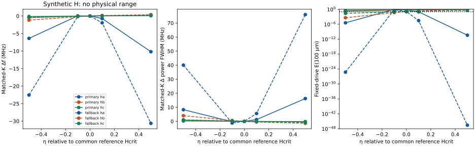

# PAPER A — A0-S reciprocal-H sensitivity

**Date:** 2026-11-05. **Overall recommendation: REVISE. Physical H range: unresolved. Coupling novelty: NOVELTY UNRESOLVED.**

This screen compares H = 0 and H ≠ 0 at **identical C, e, κ, ρ, A, mobility, diffusion, carrier concentration, thickness, face conditions and geometry within each comparison**. The added interaction remains solely

\[
\Delta\mathcal H=\nu H_{jkl}\varepsilon_{jk,l},\qquad\nu=\Delta n.
\]

No extra optical, excitonic, trap or deformation-potential field is introduced. The original [Blueprint V2.1](PAPER_A_BLUEPRINT_V2_1.md) and the f = 0 limitation of the executed controls are unchanged.

## 1. Allowed reciprocal coefficients and stability

The retained 6mm symmetry allows

\[
H_{333}=h_a,\quad H_{113}=H_{223}=h_b,\quad
H_{131}=H_{311}=H_{232}=H_{322}=h_c.
\]

In the sagittal problem,

\[
H:\nabla\varepsilon
=h_a u_{3,33}+(h_b+h_c)u_{1,13}+h_cu_{3,11}.
\]

Both reciprocal changes are retained:

\[
\Delta\tau_{jkl}=H_{jkl}\nu,\qquad
\widetilde\mu=a\nu+H:\nabla\varepsilon-q\phi,
\quad \Gamma_i=-\frac{n_0M}{q}\widetilde\mu_{,i},
\quad a=qD/(Mn_0).
\]

H is measured in **J m** for the electron-number convention. It is not interchangeable with a charge-density-normalized or dimensionless-carrier coefficient.

For the **synthetic** A = ℓ² C ⊗ I, use the full **three-dimensional** condition

\[
\mathsf s=H:A^{-1}:H/a<1.
\]

This includes H223 and both symmetry-related shear contributions, even though plane strain does not activate all of them. Passing this Schur condition proves mathematical admissibility of the tested f = 0 subset, **not physical plausibility or stability of an uncalibrated nonzero-f material**.

### Common SI-H reference, not density-by-density tuning

Use a common reference nref = 10¹⁹ m⁻³ and ℓref = 50 nm. For each pure allowed direction, H = ηref Hcrit,ref with ηref = **0, −0.1, +0.1, −0.5, +0.5**.

| Direction | Hcrit,ref (J m) | Magnitude at \|ηref\| = 0.1 | Magnitude at \|ηref\| = 0.5 |
|---|---:|---:|---:|
| ha | 4.00970644e−22 | 4.00970644e−23 | 2.00485322e−22 |
| hb | 3.46988786e−22 | 3.46988786e−23 | 1.73494393e−22 |
| hc | 1.49634282e−22 | 1.49634282e−23 | 7.48171410e−23 |

The **same SI H** is held across the six n/d base configurations; it is not renormalized to give each candidate a favorable density-dependent effect. This is a declared constitutive control, not an empirical statement that actual H is density-independent. At the B carrier input, Schur fractions are 0.002 and 0.05 for \|ηref\| = 0.1 and 0.5; at L they are 0.01 and 0.25. Thickness does not change those fractions for fixed physical ℓ and H. Mixed directions are supported and regression-tested, but a physical multicomponent H distribution or a complete mixed-H parameter box is **not** inferred from these axis tests.

## 2. Physical calibration attempt: no defensible H range obtained

The bounded source check did not find a calibrated electron-number chemical-potential coefficient H_jkl for this ZnO model. The inspected primary [2017 ZnO-fiber exciton/luminescence study, DOI 10.1038/srep40658](https://www.nature.com/articles/srep40658) reports strain-gradient-dependent optical/exciton phenomena, band-gap gradients and a piezoelectric-field mechanism. Those are **not measurements of this electron H tensor**. Optical energy shifts were not divided by a gradient and relabelled as H.

Consequently:

- **Physical H range remains null**; even the sign is uncalibrated here.
- The table above is a **synthetic stability-bounded sensitivity scale**, not a literature estimate or credible interval.
- The inherited ℓ = 50 nm is also synthetic, and f = 0 is an incomplete control limit. The broad H = 0 thin-plate feature is already A-dependent; it must not be credited to H.
- No synthetic cancellation point is selected as the operating regime or proposed as an experimentally available material.

Source limitations are explicit in [a0s/SOURCES.md](a0s/SOURCES.md).

## 3. Comparison design and uncertainty

The formal screen includes **72 nonzero-H cases**: six synthetic-gradient n/d configurations × three allowed directions × four signed nonzero magnitudes. Each has its own MAC-tracked finite-carrier dispersion, projected interval and **101 actual complex-k frequency samples**, plus a forward midpoint control. H = 0 is shared, not counted three times. The six classical H = 0 controls and sixteen ordinary probes are separate.

Three distinct comparisons prevent a frequency-shift artifact from being mistaken for a loss effect:

1. **Own interval:** compare fcut − fmin and the minimum's curvature CΩ = d²Ω/dK² after retracking the same family.
2. **Same real K:** compare the complex temporal pole and its power FWHM at the H = 0 backward projection seed.
3. **Same real drive:** continue the backward root from H = 0 to the specified H in eight homotopy steps, with identical driving frequency. Compare actual complex k, carrier attenuation, energy flux and survival. This numerical continuation introduces no additional material parameter or coupling.

The following tables refer to the selected **B0.2-G primary** and **L0.2-G fallback** from the [operating report](PAPER_A_A0S_OPERATING_REGIME.md). Their unchanged baseline widths are **149.051211 MHz** and **149.032282 MHz**. Baseline power FWHMs are **0.327462 MHz** and **1.440760 MHz**. Baseline E100 values are **0.612175** and **0.115405**.

### Numerical resolution is not material uncertainty

- Independent matched-K pole differences are ≤ **0.00884 Hz equivalent**; matched-drive |ΔK| ≤ **2.81e−12**. These check the **same** points used in the contrasts, not just shifted own midpoints.
- For the two selected configurations and their 24 H cases, p = 24/28/32 pole spread ≤ **0.01341 Hz**, FWHM spread ≤ **0.01543 Hz**, and bandwidth spread ≤ **0.01274 Hz**. Use declared floors **1 Hz per pole / 2 Hz per FWHM**, hence **2 Hz / 4 Hz for pairwise contrasts**.
- Curvature requires care: degree, independent-propagator and step-halving discrepancies reach **7.10e−5, 4.31e−5 and 1.633e−4**, respectively, in Ω/K². Combining each case's largest observed diagnostic with its baseline gives a conservative common **contrast-resolution envelope of 2.4e−4**. This is an empirical numerical-resolution indicator, **not a rigorous bound or statistical confidence interval**.
- Accordingly, changes in Re CΩ with magnitude ≤ 2.4e−4 are **not declared resolved** here. Values only slightly above it are tentative. Frequency/FWHM changes shown below are well above their numerical floors.
- None of these errors includes unknown actual f/A/H, surface transport, source-table uncertainty, Hall factors, other damping, or model discrepancy.

## 4. Primary: B0.2-G, d = 200 nm, n0 = 2 × 10¹⁸ m⁻³

Drive held at **17.326041078 GHz** for the spatial columns. LE and E100 in this table are **same-drive**, not own-midpoint quantities. Ntr is the transport-qualified count in each H case's **own** 101-point frequency bracket.

| H direction | ηref | Δ width (MHz) | Δ Re CΩ | Δf, same K (MHz) | Δ power FWHM, same K (MHz) | LE, same drive (μm) | E100, same drive | Ntr /101 |
|---|---:|---:|---:|---:|---:|---:|---:|---:|
| ha | −0.1 | +0.042793 | −0.000087 | +0.052182 | −0.295080 | 2060.3 | **0.95262** | 99 |
| ha | +0.1 | +0.231389 | +0.000172 | −0.710561 | +1.252462 | 42.326 | **0.094175** | 0 |
| ha | −0.5 | +2.981341 | +0.000922 | −6.380125 | +8.287512 | 7.9867 | **3.6497e−6** | 0 |
| ha | +0.5 | +3.949671 | +0.002261 | −10.189695 | +16.229173 | 4.1690 | **3.8260e−11** | 0 |
| hb | −0.1 | +0.266412 | +0.000163 | −0.069839 | +0.135064 | 144.50 | 0.50055 | 94 |
| hb | +0.1 | −0.136845 | −0.000367 | +0.057498 | −0.111660 | 309.09 | 0.72359 | 99 |
| hb | −0.5 | +2.651632 | −0.000765 | −0.472655 | +0.911171 | 54.832 | 0.16142 | 58 |
| hb | +0.5 | +0.617353 | −0.003578 | +0.164094 | −0.324877 | 26721 | 0.99626 | 94 |
| hc | −0.1 | +0.069796 | +0.000126 | −0.022617 | +0.043971 | 179.72 | 0.57327 | 98 |
| hc | +0.1 | −0.056639 | −0.000126 | +0.021121 | −0.041172 | 233.02 | 0.65106 | 99 |
| hc | −0.5 | +0.480900 | +0.000715 | −0.128042 | +0.247941 | 116.35 | 0.42338 | 89 |
| hc | +0.5 | −0.151721 | −0.000472 | +0.090649 | −0.177934 | 446.39 | 0.79930 | 100 |

**Interpretation:** ha has the strongest tested effect on carrier loss. A modest **synthetic** negative value can suppress the existing electrochemical drive; a positive value of the same reference magnitude can make the 100 μm screen fail. Larger stable values leave essentially no surviving energy despite a wider projected frequency interval. Hb can also strongly suppress or increase loss; hc produces smaller, still resolved frequency/FWHM effects at this operating K. The smallest curvature differences are below the stated numerical resolution, not evidence of a resolved curvature mechanism.

All twelve same-drive roots remain positive-phase, passive and **negative-Px** in these selected thin-plate tests. Their vE lies approximately **−425.1 to −418.8 m/s**: the decisive change is attenuation, **not a reversal of energy direction**. Mathematical backward direction does not rescue the negligible-survival ha cases.

## 5. Fallback: L0.2-G, d = 200 nm, n0 = 10¹⁹ m⁻³

Drive held at **17.325774742 GHz** for the spatial columns; material parameters are the literature-model transport set, not a measured 200 nm sample.

| H direction | ηref | Δ width (MHz) | Δ Re CΩ | Δf, same K (MHz) | Δ power FWHM, same K (MHz) | LE, same drive (μm) | E100, same drive | Ntr /101 |
|---|---:|---:|---:|---:|---:|---:|---:|---:|
| ha | −0.1 | +0.082037 | −0.000275 | −0.139462 | −1.210286 | 289.74 | **0.70812** | 98 |
| ha | +0.1 | +0.664913 | +0.000469 | −1.939132 | +5.567039 | 9.5817 | **2.9339e−5** | 0 |
| ha | −0.5 | +7.490721 | +0.000538 | −22.538575 | +40.051839 | 1.7198 | **5.5824e−26** | 0 |
| ha | +0.5 | +10.457857 | +0.003882 | −30.619617 | +76.013142 | 0.93258 | **2.6961e−47** | 0 |
| hb | −0.1 | +0.682914 | +0.000388 | −0.174247 | +0.593426 | 32.934 | **0.048010** | 0 |
| hb | +0.1 | −0.345996 | −0.000920 | +0.142895 | −0.490024 | 70.112 | 0.24020 | 79 |
| hb | −0.5 | +6.855155 | −0.002951 | −1.179443 | +4.021468 | 12.789 | **0.00040198** | 0 |
| hb | +0.5 | +1.658463 | −0.009435 | +0.399054 | −1.422952 | 3938.8 | 0.97493 | 71 |
| hc | −0.1 | +0.177893 | +0.000277 | −0.056118 | +0.193030 | 40.882 | **0.086632** | 0 |
| hc | +0.1 | −0.143090 | −0.000306 | +0.052272 | −0.180620 | 52.913 | 0.15109 | 59 |
| hc | −0.5 | +1.236759 | +0.001713 | −0.318774 | +1.090303 | 26.584 | **0.023247** | 0 |
| hc | +0.5 | −0.367062 | −0.001228 | +0.222710 | −0.779739 | 101.01 | 0.37157 | 82 |

All twelve same-drive selected fallback roots retain **Px < 0**, passive direction and positive phase, with vE approximately **−430.4 to −418.0 m/s**. Yet many are unusably attenuated. The H = 0 fallback has only **11.54% one-leg E100**, so it is particularly sensitive to an uncalibrated H. **It is not robust over this synthetic stability-admissible set.** Neither selection is promoted to physical feasibility by choosing a favorable sign.

Solid lines: primary. Dashed: fallback. Each line is a sparse axis sensitivity illustration, not a fitted physical H law or a guarantee between tested points. The survival panel retains the extremely lossy points rather than clipping them at a favorable floor.

## 6. Other thicknesses and the one-wavelength safeguard

All six base synthetic-gradient configurations were evaluated, not only the favorable 200 nm pair. The 0.5/1 μm cases remain below the combined transport criterion for every tested H axis/magnitude, even where an admissible backward root appears. The detailed independent/degree curvature contrasts above cover the selected pair and all 24 of their H variants. The other 48 H cases are bounded rejection screens; tiny frequency or curvature changes retained in their CSV rows are **not automatically claimed numerically resolved or experimentally observable**.

A useful counterexample is **B1-G with ha, ηref = −0.5**:

- Actual midpoint K = **0.000480784 − 0.011507387 i**, negative energy flux, vE = **−33.81 m/s**.
- LE = **43.450 μm** and E100 = **0.10011** might look acceptable if only the physical travel distance were considered.
- Its phase wavelength is **13.069 mm**, and energy surviving one wavelength is only **2.38 × 10⁻¹³¹**.

It is therefore **not a feasible propagating-wave candidate** under the declared criterion. Other exterior-growing formal roots and extremely attenuated roots likewise remain rejected. Counts or solver convergence are not substitutes for usable transport.

Complete per-case intervals, complex roots, linewidths, forward controls, decay lengths and radiation flags are in [H_summary.csv](a0s/results/H_summary.csv), [spatial_port_screen.csv](a0s/results/spatial_port_screen.csv) and [screening.json](a0s/results/screening.json). Actual same-drive complex roots and velocities are also retained in [matched_controls.csv](a0s/results/matched_controls.csv).

## 7. Ordinary-parameter controls and identifiability

For each selected H = 0 case, eight separate controls use retained tabulation-scale **c33 ±0.5 GPa, c44 ±0.05 GPa, e33 ±0.005 C/m²**, and illustrative joint **M/D ±5%**, preserving D/M. They are **one-at-a-time resolution/sensitivity probes, not measured confidence intervals**, a complete covariance study or a full parameter-uncertainty box. When C changes, the declared synthetic law **A = ℓ² C(model)** changes with it; physical A is **not independently held at C(base)** in those ordinary probes. A is unchanged in every H-only comparison above.

| Observed range over eight ordinary controls | Primary | Fallback |
|---|---:|---:|
| Same-K Δf | −17.3981 to +17.3687 MHz | −17.3989 to +17.3695 MHz |
| Same-K Δ power FWHM | −2.3165 to +2.3231 kHz | −35.8604 to +32.1891 kHz |
| Own projected bandwidth change | −1.51450 to +1.52878 MHz | −1.51451 to +1.52879 MHz |
| Own-midpoint E100 | 0.60882–0.61551 | 0.10997–0.12178 |
| Same-drive E100 | 0.59996–0.61389 | 0.10598–0.12178 |

The calculated H linewidth effects often exceed these particular ordinary probes and the numerical floor. **That is a sensitivity finding, not physical identification of H.** Many frequency shifts are smaller than the ordinary-constant frequency probes; some large synthetic-ha shifts are comparable or larger. Unknown f/A, carrier transport, surface conditions and untested parameter covariance prevent a uniqueness or experimental observability claim. A large frequency shift alone does not isolate the proposed interaction.

The H = 0 primary remains comfortably above the transport threshold under these eight controls; the fallback remains just above it. Neither is robust to the full tested synthetic H set, and neither has empirical higher-order calibration. Data: [ordinary controls](a0s/results/ordinary_parameter_controls.csv), [matched controls](a0s/results/matched_controls.csv), [independent matched-point validation](a0s/results/matched_point_validation.csv).

## 8. Closest prior art: bounded recheck complete, substantive comparison incomplete

Closest consequential target: Qu et al., *A thermodynamically consistent theory for flexoelectronics: Interaction between strain gradient and electric current in flexoelectric semiconductors*, IJES 208, 104165 (2025), [DOI 10.1016/j.ijengsci.2024.104165](https://doi.org/10.1016/j.ijengsci.2024.104165).

A0-S made **one fresh repository-targeted query** for Qu/104165/Appendix; it did not expose the primary Appendix C constitutive equations. The old inaccessible publisher/API/PDF routes and completed connected-file searches were **not repeatedly retried**. The access ledger is in [a0s/SOURCES.md](a0s/SOURCES.md); the exact comparison criteria and earlier access results remain in [A0-R novelty comparison](PAPER_A_A0R_NOVELTY_COMPARISON.md).

**NOVELTY UNRESOLVED.** We cannot assert absence, equivalence, novelty or a special-case relationship without the actual potential, carrier-variable convention, reciprocal laws and boundary terms. The new numerical sensitivity does not resolve that literature question.

## 9. H-screen conclusion

The reciprocal term is symmetry-/stability-admissible and produces numerically resolved **synthetic** dispersion and attenuation changes. Within the selected thin-plate tests it changes losses much more consequentially than energy direction; wider projected intervals can coexist with essentially no transported energy. Some small curvature effects remain numerically unresolved.

**No defensible physical ZnO H range has been obtained, and no unique physical H signature or negative reflection has been established. Overall A0-S: REVISE. STOP after this checkpoint; no edge scattering or manuscript.**
