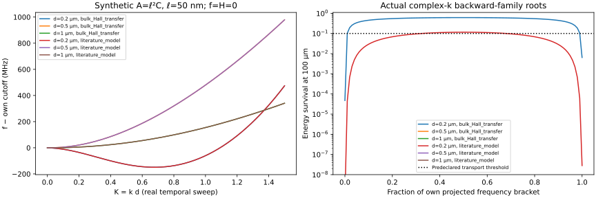

# PAPER A — A0-S operating-regime screening

**Date:** 2026-11-05. **Overall recommendation: REVISE.**

**Result:** two **conditional numerical targets**, not two experimentally qualified ZnO plates, survive the declared transport screen. Both require the existing **synthetic** gradient law with ℓ = 50 nm at total thickness d = 200 nm. No sourced classical-limit case meets the transport criterion. No negative reflection is demonstrated.

The objective, ZnO family, geometry, one added reciprocal interaction and [Blueprint V2.1](PAPER_A_BLUEPRINT_V2_1.md) are unchanged. This is the separately authorized A0-S checkpoint following A0-R. **No edge solver or manuscript was started.** The [model-selection report](PAPER_A_A0S_MODEL_SELECTION.md) gives the primary/fallback decision; the [H report](PAPER_A_A0S_H_SENSITIVITY.md) explains its substantial qualifications.

## 1. Bounded inputs and evidence status

The [protocol](a0s/protocol.json) was frozen before the formal runner and selection. It explicitly incorporates the disclosed exploratory cutoff/thickness observations; this is **not a claim of blind preregistration**. No favorable additional density, thickness or coefficient range was searched afterward.

| Input | Value used | Evidence / assumption |
|---|---|---|
| **B:** bulk-Hall-derived carrier input | n0 = 2 × 10¹⁸ m⁻³; M = 0.0175 m²/(V s) | Paired room-temperature **bulk** concentration and Hall mobility, light-green hydrothermal ZnO sector, Suscavage et al. (1999), [DOI 10.1557/S109257830000260X](https://link.springer.com/article/10.1557/S109257830000260X). Conversion: 2 × 10¹² cm⁻³ and 175 cm²/(V s). Hall-to-drift and post-thinning transfer are assumptions. |
| B diffusion | D = 0.000455 m²/s | **Derived**, not measured: D/M = 0.026 V, preserving the retained Einstein ratio. |
| **L:** literature-model carrier input | n0 = 10¹⁹ m⁻³; M = 0.01 m²/(V s); D = 0.00026 m²/s | Retained Zhang modelling inputs, [DOI 10.1007/s10483-025-3272-7](https://www.amm.shu.edu.cn/article/2025/0253-4827/0253-4827-2025-07-1331.shtml). Not a jointly measured candidate plate. |
| Thicknesses | **0.2, 0.5, 1 μm total thickness** | Design grid, not measured released samples. Submicron film literature supports a processing **scale only**, not a matching freestanding homogeneous 6mm plate. |
| Common classical constants | Unchanged `a0/materials.json` | Literature-table C, e, κ, ρ; underlying same-specimen measurements/covariance remain unaudited. cs(reference) = 2746.608754 m/s. |
| **C** control | f = A = H = 0 | Sourced classical-material **limit**, not the full prescribed flexoelectric model. |
| **G** control | f = H = 0; A = ℓ² C ⊗ I; ℓ = **50 nm** | **Synthetic**, inherited from A0-R, not a measured ZnO gradient modulus. Physical ℓ is fixed across d and n0. Thus ℓ/d = 0.25, 0.1, 0.05. |

Both transport sets retain D/M = 0.026 V, corresponding to effective T ≈ **301.717 K**. Approximate room-temperature transfer is not exact same-sample temperature calibration. No 10¹⁷ m⁻³ operating input is reused as if experimentally established. Bulk donor/acceptor concentrations are not substituted for free-electron n0.

Primary-source details, the limited film-thickness evidence, and rejected nonmatching membrane/exciton evidence are recorded in [a0s/SOURCES.md](a0s/SOURCES.md). **No empirical nonzero f, A, H, mechanical-loss constant, or material uncertainty interval was invented.**

## 2. What the frequency interval and transport tests mean

Use exp(i k x1 − i ω t), K = k d and Ω = ω d/cs. At real K, the finite-rate temporal pole is Ω = Ωr − iγd/cs. Its isolated-pole **power FWHM** is

\[
\Delta f_{\mathrm{FWHM}}=\gamma/\pi
=-2\Im\Omega\,c_s/(2\pi d).
\]

This is not HWHM, spatial attenuation, or a measured driven-response bandwidth. For real drive and k = β + iκ,

\[
L_A=1/|\kappa|,\qquad L_E=1/(2|\kappa|),\qquad
E(L)/E(0)=e^{-L/L_E}.
\]

Near a zero-group-velocity point, **L_E is calculated from complex k**, not inferred from group velocity times a temporal lifetime.

### Fixed branch and port domain

- Follow the lowest K = 0 oscillatory thickness mode with >90% U3 kinetic-mass fraction in the retained L1 parity. Sweep **0 ≤ K ≤ 1.5**, ΔK = 0.01, using mechanical mass **MAC**, not nearest-frequency jumps. Every formal case has minimum adjacent-step MAC > 0.98.
- Locate the first minimum of **Re Ω(K)**, Kz. The interval **[Re Ω(Kz), Re Ω(0)]** is a **real-frequency projection of lossy poles**, not a strict passband of a dissipative spectrum.
- Within each case's own projected interval, calculate **101 real-frequency complex-k backward-family roots**, with continuation from the midpoint, and a forward partner at the midpoint. Numerical root failure would be marked unresolved, not physical nonexistence. **All sampled roots were numerically resolved.**
- A screened positive-phase backward port requires **Re K > 0, Px < 0, Im K < 0, positive stored energy**, passive attenuation and the conservative light-line guard described below. Negative dispersion slope alone is insufficient.
- The predeclared transport criterion is **E(100 μm) ≥ 0.1 AND E(one phase wavelength) ≥ 0.1**, with relative electromagnetic-exponent diagnostic ≤ 0.01. This is a one-leg engineering screen, not an experimental threshold or edge-reflection efficiency.

Finite carrier drift–diffusion is active throughout the following tables. The old frozen-carrier target frequency is **not** reused as the operating interval.

## 3. All twelve H = 0 operating cases

Labels combine carrier set **B/L**, thickness in μm and model **C/G**. Computed digits below describe this mathematical model, not physical material accuracy.

### 3.1 Carrier-shifted projected intervals and temporal linewidths

FWHM is evaluated at the real-K backward projection seed corresponding to the interval midpoint. The actual complex spatial root is independently computed afterward.

| Case | Projected fmin–fcut (GHz) | Width (kHz) | Temporal power FWHM (kHz) | Kz |
|---|---|---:|---:|---:|
| B0.2-C | 16.244884608–16.245176498 | 291.890 | 372.887 | 0.02167469 |
| B0.2-G | 17.251515472–17.400566684 | 149051.211 | 327.462 | 0.67692943 |
| B0.5-C | 6.497883713–6.498000335 | 116.622 | 690.035 | 0.02166038 |
| B0.5-G | 6.678581741–6.678640622 | 58.881 | 658.933 | 0.01002133 |
| B1-C | 3.248930482–3.248988771 | 58.289 | 785.473 | 0.02165582 |
| B1-G | 3.278535805–3.278583398 | 47.593 | 772.095 | 0.01718697 |
| L0.2-C | 16.244558971–16.244850220 | 291.249 | 1686.075 | 0.02164722 |
| L0.2-G | 17.251258601–17.400290882 | 149032.282 | 1440.760 | 0.67691622 |
| L0.5-C | 6.497753615–6.497869981 | 116.366 | 2211.302 | 0.02163313 |
| L0.5-G | 6.678460377–6.678519132 | 58.755 | 2101.058 | 0.01000885 |
| L1-C | 3.248863033–3.248921184 | 58.151 | 2314.187 | 0.02162664 |
| L1-G | 3.278469971–3.278517452 | 47.481 | 2273.669 | 0.01716395 |

The broad **149 MHz** feature at 200 nm is caused by the chosen **synthetic gradient-elastic law and its changed thickness-mode ordering**, already at **H = 0**. It is **not an H-induced bandwidth or evidence for a measured ZnO effect**. MAC continuation and the independent strong-equation check prevent attributing a mode-index switch to this feature. The narrow 0.5/1 μm features cannot be rescued by looking only at their lossless negative slopes.

### 3.2 Actual complex-k midpoint roots and backward transport

Here Kb denotes the backward-family continuation, not an assertion that it is physically admissible. For negative Re K, the retained analytic sheet qES = K **grows outside the plate**. Such roots are rejected; their physical backward transport quantities are **undefined**, not zero. They are not reinterpreted as modes on another exterior sheet.

| Case | Complex Kb | vE (m/s) | LE (μm) | E100 | Eλ | Admitted /101 | Transport /101 |
|---|---|---:|---:|---:|---:|---:|---:|
| B0.2-C | 0.004131462 − 0.008555356 i | −27.39 | 11.689 | 1.9251e−4 | 4.9969e−12 | 90 | **0** |
| B0.2-G | 0.320992366 − 0.000490737 i | −419.25 | 203.775 | 0.61217 | 0.98097 | 101 | **99** |
| B0.5-C | −0.006983994 − 0.02427221 i | — | — | — | — | 0 | 0 |
| B0.5-G | −0.007505105 − 0.01605377 i | — | — | — | — | 0 | 0 |
| B1-C | −0.019599780 − 0.03843068 i | — | — | — | — | 0 | 0 |
| B1-G | −0.018517640 − 0.03365970 i | — | — | — | — | 0 | 0 |
| L0.2-C | −0.006720991 − 0.02394959 i | — | — | — | — | 0 | 0 |
| L0.2-G | 0.320996617 − 0.002159312 i | −419.17 | 46.311 | 0.11540 | 0.91894 | 101 | **35** |
| L0.5-C | −0.026804949 − 0.04610769 i | — | — | — | — | 0 | 0 |
| L0.5-G | −0.020364578 − 0.02957868 i | — | — | — | — | 0 | 0 |
| L1-C | −0.047614951 − 0.06770110 i | — | — | — | — | 0 | 0 |
| L1-G | −0.042984847 − 0.05901572 i | — | — | — | — | 0 | 0 |

Eλ is energy surviving **one phase wavelength**, not one thickness. B0.2-C illustrates why an admissible backward-energy root is not necessarily a useful wave: only 0.0193% survives 100 μm, and about 5 × 10⁻¹² survives one wavelength. **It is not feasible under the declared screen.** Counts are sampled frequencies in each case's own bracket, not angular reflection channels or a nonexistence proof outside the bounded domain.

### 3.3 Complex temporal poles and forward controls

These are distinct eigenproblems: Ω is complex at a real temporal reference K; the forward K is complex at the real midpoint drive. All listed forward controls have positive phase, positive energy flux, passive attenuation and decaying Laplace exteriors. Their detailed radiation diagnostics are retained in the JSON.

| Case | Complex temporal Ω | Forward complex K | Forward LE (μm) | Forward E100 |
|---|---|---|---:|---:|
| B0.2-C | 7.432477387 − 8.530232e−5 i | 0.039210599 + 0.008512219 i | 11.748 | 2.0100e−4 |
| B0.2-G | 7.927064717 − 7.491065e−5 i | 0.974474492 + 0.000258394 i | 387.006 | 0.77229 |
| B0.5-C | 7.432397095 − 3.946339e−4 i | 0.050297067 + 0.02407742 i | 10.383 | 6.5663e−5 |
| B0.5-G | 7.639047896 − 3.768462e−4 i | 0.027546771 + 0.01597658 i | 15.648 | 0.0016772 |
| B1-C | 7.432371049 − 8.984302e−4 i | 0.062902066 + 0.03799050 i | 13.161 | 0.0005014 |
| B1-G | 7.500084417 − 8.831280e−4 i | 0.052886316 + 0.03333174 i | 15.001 | 0.0012730 |
| L0.2-C | 7.432328254 − 3.857092e−4 i | 0.050007752 + 0.02375788 i | 4.2091 | 4.8093e−11 |
| L0.2-G | 7.926942862 − 3.295904e−4 i | 0.974442857 + 0.001185914 i | 84.323 | 0.30547 |
| L0.5-C | 7.432248141 − 1.264652e−3 i | 0.070059851 + 0.04548812 i | 5.4959 | 1.2529e−8 |
| L0.5-G | 7.638909006 − 1.201603e−3 i | 0.040380120 + 0.02933337 i | 8.5227 | 8.0218e−6 |
| L1-C | 7.432216593 − 2.646986e−3 i | 0.090843261 + 0.06640828 i | 7.5292 | 1.7055e−6 |
| L1-G | 7.499933686 − 2.600641e−3 i | 0.077296959 + 0.05805221 i | 8.6129 | 9.0709e−6 |

## 4. Selected operating targets and sample-supported transport intervals

Selection uses **H = 0**, not a favorable fitted H: rank the synthetic-gradient cases that meet both transport criteria at their **own interval midpoint**, using E100. A bulk-Hall provenance tie-break would apply within 0.05 survival; it is not needed here. No other H = 0 case qualifies.

| Quantity | **Primary: B0.2-G** | **Fallback: L0.2-G** |
|---|---:|---:|
| Design thickness / synthetic ℓ | 200 nm / 50 nm | 200 nm / 50 nm |
| Midpoint real drive | **17.326041078 GHz** | **17.325774742 GHz** |
| Backward phase wavelength | 3.91485 μm | 3.91480 μm |
| Backward amplitude / energy length | 407.550 / **203.775 μm** | 92.622 / **46.311 μm** |
| E(10 μm), E(100 μm), E(1 mm) | 0.95211, **0.61217**, 0.007392 | 0.80579, **0.11540**, 4.190e−10 |
| E(one wavelength) | **0.98097** | **0.91894** |
| Normalized Px / stored energy | −4.795915 / 31.419178 | −4.794807 / 31.418214 |
| Carrier dissipation, same normalization | 0.004707069 | 0.020706964 |
| Re Ω curvature at minimum | 0.698230 | 0.698237 |
| Sample-supported transport span | **17.253005985–17.399076172 GHz** | **17.300439254–17.351110229 GHz** |
| Sample indices / total | 1–99 / 101 | 33–67 / 101 |
| Frequency-grid spacing | 1.490512 MHz | 1.490323 MHz |

These spans are **grid-supported**, not certified continuous endpoints. The primary's lower/upper boundary brackets are [17.251515472, 17.253005985] and [17.399076172, 17.400566684] GHz. The fallback's are [17.298948931, 17.300439254] and [17.351110229, 17.352600552] GHz. Numerical pole error is much smaller than this **sampling** uncertainty; the two must not be confused.

For a hypothetical 100 μm incident leg plus 100 μm backward return, the computed forward/backward survival product is **0.47278 primary** and only **0.03525 fallback**, even before any imperfect edge conversion. These are conditional transport ceilings for this calculated mode pair with unit conversion, **not reflection coefficients**. The fallback is consequently marginal, not equivalent to the primary. No millimetre-scale low-loss claim is made.

The right-hand plot has physical positive-sheet curves only for the two 200 nm cases; the thicker cases have no admitted backward port in their sampled brackets. It shows E100, not the additional one-wavelength guard or edge efficiency.

## 5. Exterior and radiation admissibility: what is and is not checked

The Laplace exterior is solved on **qES = K**. Re K > 0 is indispensable for decay; algebraic root accuracy alone does not establish this.

As a conservative kinematic consistency check, calculate

\[
K_{\rm light}=\Omega c_s/c,\qquad
q_{\rm EM}=\sqrt{K^2-K_{\rm light}^2},\quad\Re q_{\rm EM}>0,
\]

using exact c = 299792458 m/s. Check Re K > Klight and report |qEM/K − 1|. For both selected backward roots, Klight ≈ **7.2625 × 10⁻⁵**, Re K ≈ **0.321**, and the exponent difference is **2.56 × 10⁻⁸**. The corresponding forward difference is about **2.78 × 10⁻⁹**. Their phase wavenumbers are far greater than ω/c, on the **large-wavenumber, subluminal-phase side** of the vacuum light line within this diagnostic. Vacuum contains no elastic radiation continuum.

**This does not solve the full Maxwell outgoing-wave problem or evaluate radiated power.** The retained bulk/electric boundary equations remain quasistatic; magnetic fields and electromagnetic energy corrections have not been added. Kinematic screening therefore does **not** close the mandatory electrodynamic radiation-admissibility gate. No field/geometry expansion was silently introduced to force a physical PASS.

## 6. Independent validation and numerical uncertainty

**1,254/1,254 formal numerical checks and 136/136 final-audit checks passed.** A0-S has **22/22 tests**; retained A0-R **65 checks / 16 tests** and A0 **52 checks / 12 tests** were rerun and passed. All ten retained source/blueprint hashes match. Numerical success is not a research PASS.

The independent verification now includes a **separately derived twelve-state strong-equation propagator** for the executed f = 0, A = ℓ²C subset with all three reciprocal H components. It uses no Galerkin stiffness/basis/differentiation matrices. The retained eight-state method verifies the classical cases. The derivation, state variables and boundary conditions are in [a0s/STRONG_VALIDATION.md](a0s/STRONG_VALIDATION.md). Both selected H = 0 cases and all 24 selected-configuration nonzero-H tests receive degree and strong-equation validation; all twelve base cases receive independent temporal/spatial checks.

| Numerical diagnostic | Maximum observed |
|---|---:|
| Independent complex temporal pole / endpoint discrepancy, main checks | 0.00820 Hz equivalent |
| Independent complex spatial-root discrepancy, main checks | 3.27e−12 in K |
| Independent **same-K H/probe** pole discrepancy, 40 matched comparisons | 0.00884 Hz equivalent |
| Independent **same-drive** spatial discrepancy, matched comparisons | 2.81e−12 in K |
| p = 24/28/32 complex-pole spread, selected configurations and their H tests | 0.01341 Hz equivalent |
| Corresponding power-FWHM spread | 0.01543 Hz |
| Corresponding projected-bandwidth spread | 0.01274 Hz |
| Corresponding complex-K spread | 3.14e−12 |
| Independent strong/Galerkin power, energy or dissipation relative difference | 1.52e−11 |
| All positive-sheet sampled roots: maximum governing/face residual | 2.96e−10 |
| All positive-sheet sampled roots: maximum spatial energy-balance error | 1.90e−8 |
| Minimum reconstructed positive-sheet stored energy, mass-normalized | 27.6212, positive |

Reporting floors are **1 Hz per pole, 2 Hz per power FWHM**. Curvature is more sensitive to finite differencing: maximum degree discrepancy is 7.10e−5, independent-curvature discrepancy 4.31e−5 and step-halving discrepancy 1.633e−4 in Ω/K². The H report uses a conservative contrast-resolution envelope rather than declaring every small curvature change significant.

The directly integrated balance is

\[
2\Im K\,P_x=\mathcal D,\qquad\mathcal D\ge0.
\]

Chemical/electrical power, exact Laplace exterior contributions and **free-face tangential-hyperstress power** are included. For example, primary midpoint vacuum power = −0.442640 and face correction = +0.570657 in the same arbitrary modal normalization. They cannot simply be dropped. The independent strong-state solution separately reconstructs and quadratures these quantities.

High-order mechanical DOFs are **exactly Schur-condensed, not truncated**, to avoid raw gradient-stiffness roundoff in complex-k Newton steps. The determinant identity, independent roots, field residuals and convergence validate that conditioning change. Retained A0/A0-R implementations are not edited.

## 7. Evidence boundary and audit files

There is **no experimentally qualified full-model operating regime yet**. Missing evidence includes released-plate n/M after surface/depletion changes, Hall-to-drift/GHz transport transfer, empirical f/A/H, other intrinsic material loss, exact electromagnetic radiation admissibility and Qu's actual closest equations. The source's deep-donor fit does not establish GHz trap equilibration. No additional trap or optical field was introduced.

This is a bounded first-family study, not a global nonexistence proof over every mode, exterior sheet, thickness or density. A forward/backward pair at normal sagittal propagation is a prerequisite only: **no off-normal edge-matching, conversion coefficient, angular energy-flux result or genuine negative reflection has been calculated**.

Small auditable outputs:

- [Complete screening JSON](a0s/results/screening.json): all 12 base, 72 nonzero-H and 16 ordinary-probe cases; complex temporal poles, backward/forward spatial roots, radiation flags, energy, intervals and validation.
- [Operating summary](a0s/results/operating_summary.csv), [H summary](a0s/results/H_summary.csv), [ordinary controls](a0s/results/ordinary_parameter_controls.csv): complete per-configuration quantities, including forward controls.
- [Temporal sweep](a0s/results/temporal_dispersion.csv): **15,100** rows; [spatial screen](a0s/results/spatial_port_screen.csv): **10,100** rows, including rejected exterior roots and positive-energy audit columns.
- [Independent propagator](a0s/results/independent_propagator.csv), [degree convergence](a0s/results/complex_convergence.csv), [matched-point validation](a0s/results/matched_point_validation.csv), [selected forward validation](a0s/results/selected_forward_validation.csv).
- [Formal validation](a0s/results/validation.json), [final audit](a0s/results/final_audit.json), [retained hashes](a0s/results/retained_sha256.json), [source ledger](a0s/SOURCES.md).

**REVISE. Stop after A0-S.**
