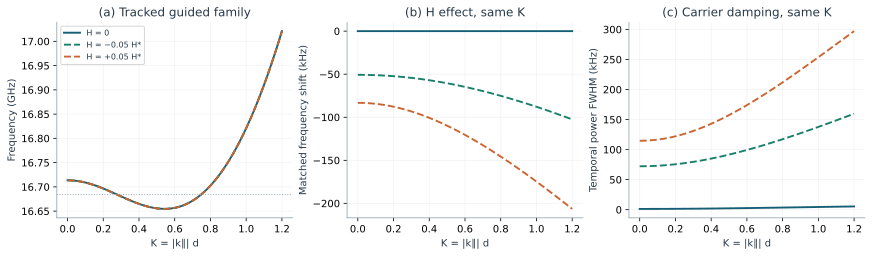
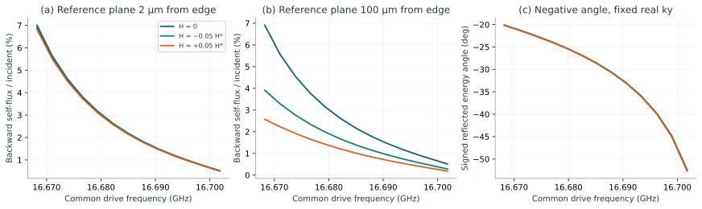
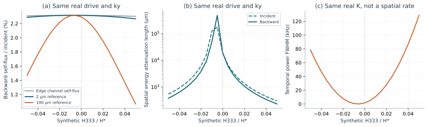
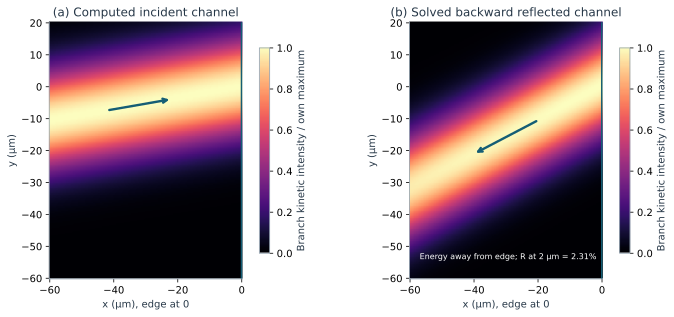

# Negative Reflection in a Flexoelectric Piezoelectric-Semiconductor Plate

## Focused mathematical study — 5 November 2026

**Result.** A solved **2D plane-strain plate-edge problem**, with out-of-plane invariance and a specified propagation-plane tangential component, produces a nonzero backward reflected channel with negative physical energy flow. At the selected drive, its isolated-channel return is **2.315%** at a plane 2 μm from the edge, and its thickness-integrated energy flow is directed **−27.90°** relative to the outward normal of the x = 0 edge. This is an edge-conversion calculation, not an inference from a negative dispersion slope. Synthetic H chiefly changes carrier damping and finite-distance return; it does **not** create the backward branch in this example.

**Important boundary of the result.** This is **not a verified reproduction of Fang or Wei**, not an experimentally calibrated ZnO prediction, and not a demonstrated novel coupling. Complete Fang/Wei equations and Qu's relevant appendix remained unavailable after bounded searches. The calculations were continued rather than held behind another approval checkpoint. Pointwise corner stresses are not certified; the energy-consistent **variational** edge conditions and channel coefficients are the converged quantities.

### 1. Published reference and the explicit specialization

**Wei et al. (2026)** is the closer structural reference: a semiconductor *plate* with guided waves. **Fang et al. (2025)** instead studies SH waves in a ZnO layer supported by diamond. Neither accessible preview supplies the complete governing model needed for a defensible transcription. Wei also treats dynamic flexoelectricity/nonlocality/micro-inertia and uses Nb-doped SrTiO₃ numerically. Those features are **not silently imported, reconstructed from an abstract, or claimed reproduced here**. No claim is made that H vanishes in Fang's geometry.

To finish a useful calculation despite this source gap, the present report specifies an independent, minimal **static/local electric-enthalpy specialization**, with ZnO classical constants from the accessible Zhang et al. source. It retains displacement **u**, potential φ, and carrier perturbation ν = Δn. The electrochemical potential μ below is an exactly eliminable numerical auxiliary, **not an extra physical field or theory**. All three elastic polarizations are necessary for oblique edge matching. Only the requested H interaction is new relative to this specified reference model.

Let ε be infinitesimal strain, g = ∇ε, E = −∇φ, q > 0, and

\[
 a=\frac{qD_n}{M n_0},\qquad b=\frac{n_0M}{q}.
\]

The reference electric enthalpy and its sole added term are

\[
 \mathcal H_0=
 \tfrac12\varepsilon:C:\varepsilon+\tfrac12g:A:g
 -E\cdot(e:\varepsilon+f:g)-\tfrac12E\cdot\kappa E
 +\tfrac12a\nu^2-q\phi\nu,
 \qquad \boxed{\Delta\mathcal H=\nu H:g}.
\]

This equation **defines the computed model**, rather than attributing unseen equations to Wei. Its usual balance laws are

\[
 \rho\ddot u_i=\partial_j S_{ij},\quad
 S_{ij}=\sigma_{ij}-\partial_l\tau_{ijl},\quad
 \nabla\cdot\mathbf D=-q\nu,\quad
 \dot\nu+\nabla\cdot\boldsymbol\Gamma=0,
 \qquad \boldsymbol\Gamma=-b\nabla\mu.
\]

The baseline constitutive quantities are σ = C:ε − eᵀE, τ₀ = A:g − fᵀE, D = e:ε + κE + f:g, μ₀ = aν − qφ. No electric-field-gradient, dynamic-flexoelectric, gradient-inertia, surface-carrier, recombination or exciton terms are added.

### 2. Only the H-dependent changes

Differentiation of the one added energy gives

\[
 \boxed{\Delta\tau_{ijl}=\nu H_{ijl},\qquad
        \Delta\mu=H:g,\qquad
        \Delta\sigma=0,\quad\Delta\mathbf D=0.}
\]

For a uniform H tensor,

\[
 \Delta S_{ij}=-\partial_l(\nu H_{ijl}),\qquad
 \Delta f_i^{\mathrm{mech}}=-H_{ijl}\partial_j\partial_l\nu,
 \qquad \Delta\boldsymbol\Gamma=-b\nabla(H:g).
\]

Thus reciprocal mechanical and carrier terms are retained together. H is not a one-way forcing or a change to local Cauchy stress. It has units **J m**.

On a flat surface with normal n and tangential derivative 𝒟, the changed traction, double traction and blocking condition are

\[
 \Delta t_i=-n_j\partial_l(\nu H_{ijl})
             -\mathcal D_j(n_l\nu H_{ijl}),\qquad
 \Delta r_i=n_jn_l\nu H_{ijl},\qquad
 \Delta(\mathbf n\cdot\boldsymbol\Gamma)
       =-b\,\mathbf n\cdot\nabla(H:g).
\]

At an intersection of faces, the changed line force is Σfaces mⱼnₗνHᵢⱼₗ, with m the outward surface conormal. These corner terms are included in the weak edge balance, not discarded.

**Numerical tensor choice:** H₃₃₃ = H, all other H components zero, so H:g = H u₃,₃₃. On the upper plate face, Δt₃ = −Hν,₃ and Δr₃ = Hν. At the vertical x = 0 edge, this tensor has **no direct mechanical edge-traction or line-force contribution**; it still changes the solution and the carrier condition, through ΔΓ₁ = −bH u₃,₃₃₁. Electrical boundary conditions have no direct H addition.

### 3. Geometry, sourced properties and synthetic inputs

The plate occupies **x < 0**, −d/2 < z < d/2, is infinite in y, and has c-axis along z. The edge at x = 0 and the two faces are mechanically free, electrically **grounded (φ = 0)**, and carrier-blocking (n·Γ = 0). These are idealized, massless electrical boundaries, **not an unelectroded/open-vacuum plate or an ohmic carrier contact**. Electrode mechanics and losses are omitted. Grounding changes dispersion and loss: the earlier open/vacuum, f = 0 checkpoint values must not be reused for this calculation.

| Input | Value | Evidence/status |
|---|---:|---|
| C₁₁, C₁₂, C₁₃, C₃₃, C₄₄, C₆₆ | 210, 121, 105, 221, 43, 44.5 GPa | Zhang et al., Table 1; literature constants, not a sample-specific measurement audit |
| e₁₅, e₃₁, e₃₃ | −0.48, −0.57, 1.32 C/m² | Same source; engineering-Voigt convention |
| κ₁₁, κ₃₃ | 7.61, 8.85 × 10⁻¹¹ F/m | Same source; absolute permittivities |
| ρ | 5700 kg/m³ | Same source |
| n₀, M | 2 × 10¹⁸ m⁻³; 0.0175 m²/(V s) | Suscavage et al., light-green high-resistivity **bulk** ZnO sector, room-temperature Hall data |
| Dₙ | 0.000455 m²/s | **Derived** from M and retained Dₙ/M = 0.026 V, equivalent to about 301.7 K; not measured diffusivity of that Hall sample |
| d | 200 nm | Design choice; not a jointly characterized released plate |
| A | ℓ²C ⊗ I, ℓ = 50 nm | **Synthetic strain-gradient law**, not measured ZnO A |
| f | f₃₃₃₃ = 1 nC/m, others zero | **Synthetic, nonzero static flexoelectric coefficient**, not fitted/calibrated |
| H | 0 and ±2.0048532 × 10⁻²³ J m; intermediate values in figures | **Synthetic sensitivity**, not a measured/estimated physical range |

The Hall-to-drift, bulk-to-released-film and DC-to-GHz transfers are assumptions. No thin-film growth observation is used to certify this plate's transport.

For this positive-energy model the strict constitutive condition is

\[
 C>0,\quad\kappa>0,\quad a>0,\qquad H:A^{-1}:H<a.
\]

Define H* = 4.0097064 × 10⁻²² J m using **fixed reference** nref = 10¹⁹ m⁻³, the same Dₙ/M, and ℓ = 50 nm. The plotted H/H* = ±0.05 values have actual Schur ratio **0.0005** at n₀ = 2 × 10¹⁸ m⁻³. The full normal elastic compliance, not merely 1/C₃₃, is used. **Stability is not material calibration.** All ordinary parameters remain fixed across H comparisons.

### 4. Wave and edge calculation

Use exp[i(kₓx + kᵧy − ωt)], cₛ = √(C₄₄/ρ) = 2746.609 m/s, K = kd and Ω = ωd/cₛ. Through-thickness displacement, potential and carrier variables are expanded without imposed parity. In particular, nonzero f together with polar piezoelectricity can mix thickness parities; a half-plate symmetry restriction would be incorrect here.

- A **time-domain generator** supplies complex temporal poles at real K, with mass-MAC branch tracking.
- An independently assembled **spatial state operator** supplies complex kₓ at common **real ω and real kᵧ**.
- Every outgoing propagating and evanescent mode is included in edge matching. Decay into x < 0 selects complex roots; power direction selects real roots. At degree p = 22 there are **182 outgoing modes** and 182 edge equations. Rank deficiency raises an error rather than silently dividing by small singular values.
- Free-edge traction/double traction, grounding and blocking are enforced variationally, including the corner functional. The incident amplitude and all outgoing coefficients are solved, not prescribed by a ray picture.

The tracked H = 0 family has its sampled/refined minimum near K = **0.54293**. Its minimum and cutoff are **16.654675** and **16.713571 GHz**, a projected backward interval of **58.896 MHz**. This is not automatically the oblique edge-conversion interval: a conserved kᵧ can exclude part of it. The branch is already present at H = 0 in the synthetic A-dependent model; no H-created bandwidth claim is made.

The fixed numerical drive is **16.684123136 GHz**, Ω = 7.6333724044, at the midpoint of this projected interval, not an optimized conversion point. Kᵧ = **0.1298117503** gives an H = 0 incident energy angle of 10°. Across H, ω and kᵧ remain fixed; the incident angle is not artificially retuned. The selected frequency lies in the common dispersion interval of the three tracked H cases.



*Figure 1. Same tracked family and same real K in all three cases. The nearly overlapping frequency curves are resolved by the shift panel. Power FWHM is −2 Im ω/(2π), not the amplitude HWHM. Frequency shifts are numerical synthetic-coefficient effects, not physical precision estimates.*

### 5. Solved negative reflection and the effect of H

Define θᵢ = atan2(Pᵢᵧ, Pᵢₓ) and θᴮ = atan2(Pᴮᵧ, −Pᴮₓ), measured counterclockwise from the outward normal of the x = 0 edge. Ordinary reflected energy would have positive θᴮ in this convention. Genuine backward conversion here requires **a solved nonzero outgoing coefficient**, Pᵢₓ > 0, Pᵢᵧ > 0, **Pᴮₓ < 0, Pᴮᵧ < 0**, and Pᴮ·Re kᴮ < 0.

At H = 0 the solved roots are

\[
 K_{xi}=0.7361990195+5.4027187\times10^{-6}i,\qquad
 K_{xB}=0.2451746922-5.2305951\times10^{-6}i.
\]

Although Re Kₓᴮ and Kᵧ are both positive, its physical energy velocity is **(−186.02, −98.49) m/s**, versus **(378.91, 66.81) m/s** for incidence. Its nonzero solved channel coefficient therefore establishes **model-level negative edge reflection**, not ordinary reflection, negative refraction, retroreflection, or a backward slope alone. Most returned power is in other reflected channels: this is a small backward component, **not near-unity negative reflection of the whole field**. Because the edge problem fixes kᵧ = 0.1298117503, the backward root has Re Kₓᴮ = 0.2451746922, so the pair does not satisfy the classical same-|k| condition Kₓᴮ² + kᵧ² = Kₓᵢ² + kᵧ². Its nonzero kᵧ-component is energy flow within the 2D plane, not a third-dimensional oblique angle: this is a 2D plane-strain calculation, not a projected or validated 3D oblique plate-edge solution.

The following table keeps the same real frequency, real kᵧ, degree-22 edge solve, 182-mode outgoing basis, incident self-power normalization, geometry, edge conditions and 2 μm reference plane across H:

| Fixed-drive quantity (same geometry, source and normalization) | H = −0.05 H* | H = 0 | H = +0.05 H* |
|---|---:|---:|---:|
| Re kᵢₓ | 3682.191697 m⁻¹ | 3680.995098 m⁻¹ | 3683.293078 m⁻¹ |
| Im kᵢₓ (propagating/attenuation coefficient) | 0.929927 m⁻¹ | 0.0270136 m⁻¹ | 1.667167 m⁻¹ |
| Re kᴮₓ | 1224.057422 m⁻¹ | 1225.873461 m⁻¹ | 1222.771642 m⁻¹ |
| Im kᴮₓ (propagating/attenuation coefficient) | −1.326168 m⁻¹ | −0.0261530 m⁻¹ | −2.173365 m⁻¹ |
| Conserved kᵧ = Kᵧ/d | 649.058752 m⁻¹ | same | same |
| Pᵢₓ/Pᵢᵧ, normalized kinetic power | 1.0000 / 0.1763 | 1.0000 / 0.1763 | 1.0000 / 0.1762 |
| Pᴮₓ/Pᴮᵧ, normalized kinetic power | −0.01544 / −0.00819 | −0.01542 / −0.00817 | −0.01545 / −0.00820 |
| Backward energy angle from outward −x normal | −27.93° | −27.90° | −27.96° |
| Reflected mode cosine Re(kᴮₓ)/√(Re²kᴮₓ+kᵧ²) | 0.5296 | 0.5303 | 0.5308 |
| Backward channel self-flux at edge / incident self-flux | 2.307% | 2.315% | 2.301% |
| Same-plane return, **2 μm** from edge | **2.286%** | **2.315%** | **2.266%** |
| Attained-range separation, attenuation-only prediction | **2.272%** | — | **2.265%** |
| Same-plane return, **100 μm** from edge | **1.469%** | **2.291%** | **1.067%** |
| Carrier-only x attenuation length, incident/backward | 537.7 / 377.0 μm | 18,509 / 19,118 μm | 299.9 / 230.1 μm |
| Temporal power FWHM at common real K = 0.27741975 | 78.52 kHz | 1.549 kHz | 128.71 kHz |
| Frequency shift at that same real K | −53.76 kHz | 0 | −91.83 kHz |

**Interpretation:** both endpoint H signs increase carrier damping relative to H = 0 in this boundary specialization. The table separates the edge conversion, which is the ratio at the edge, from the finite-distance return, which additionally contains source-to-reference propagation attenuation. At 2 μm the H = −0.05 H* return is 0.013 percentage points below its attenuation-only attained-range prediction, while the endpoint discrepancies show that conversion and attenuation are not algebraically separable across finite distances. This is not a general claim that H must improve negative reflection. The very long H = 0 lengths include **carrier loss only** and cannot be read as experimental propagation lengths.



*Figure 2. Every frequency point solves the edge problem for all three H values at identical real ω and kᵧ. The two return panels use different physical reference distances, not different reflection solutions. Panel (c) is a signed thickness-integrated energy-angle, not the ray angle implied by the complex phase wavenumber. The displayed interval is inside the admissible backward branch, not a claim about its complete endpoints.*



*Figure 3. Twenty-one synthetic H values with fixed material, geometry, real drive and real kᵧ. Temporal linewidth in panel (c) is evaluated at a common real K; it is explicitly distinct from the spatial rates in panel (b).*

A Gaussian angular spectrum is also assembled from **solved** edge coefficients, not from an assumed reflection law. For H = 0, σ(Kᵧ) = 0.013, and 25 Gauss-Hermite nodes, the incident and backward branch kinetic intensities are shown below. At x = −40.105 μm, their transverse centroids are **−7.264 μm** and **−20.944 μm**, respectively. The reflected branch travels **away from the edge, left and down**; the incident branch travels right and up. Seventeen-to-25-node centroid change is below 10⁻⁹ μm. This is an angular-spectrum channel demonstration, not a transient/full-field simulation.



*Figure 4. Through-thickness integrated kinetic intensities computed from the modal fields and their mass Gram matrix. Each panel has its **own normalization**; the backward panel does not imply 100% conversion. Arrows indicate the independently calculated energy direction. Other reflected channels and their interference are not shown in this branch-filtered image; they are retained in the edge solve and complete power budget.*

### 6. Energy, attenuation and validation

The cycle-mean stored energy contains elastic, strain-gradient, dielectric, carrier and reciprocal H terms:

\[
 \mathscr E=\tfrac14\int\!\left[
 \rho|\omega|^2|u|^2+\varepsilon^*:C:\varepsilon+g^*:A:g
 +E^*\kappa E+a|\nu|^2+2\operatorname{Re}(\nu^*H:g)\right]dz.
\]

For real ω, the integrated transport includes **mechanical, tangential-hyperstress, electrical and chemical** power, with the free-face correction:

\[
 P_\alpha=\tfrac12\operatorname{Re}\int\!\left[
 -S_{i\alpha}v_i^*-\tau_{ij\alpha}\dot\varepsilon_{ij}^*
 +\phi\dot D_\alpha^*+\mu\Gamma_\alpha^*\right]dz
 -\tfrac12\operatorname{Re}[\tau_{i\alpha3}v_i^*]_{-d/2}^{d/2}.
\]

Carrier dissipation is 𝒟 = (b/2)∫|∇μ|²dz ≥ 0. The calculations check **−2 Im ω 𝓔 = 𝒟** for real-K temporal modes and **2 Im kₓ Pₓ = 𝒟** for real-ω spatial modes. Their lengths/rates are not interchanged:

\[
 L_A=1/|\operatorname{Im}k_x|,\quad
 L_E=1/(2|\operatorname{Im}k_x|),\qquad
 R_B(L)=R_B(0)\exp\{2[\operatorname{Im}k_{xB}-\operatorname{Im}k_{xi}]L\}.
\]

Rᴮ is an **isolated modal self-flux ratio**, not total reflectance in a dissipative, interfering multimode field. The complete control volume instead uses the full superposition:

\[
 \boxed{P_x(-L)-P_x(0)=\int_{-L}^{0}\mathcal D(x)\,dx.}
\]

All incident/outgoing and outgoing/outgoing cross terms are retained analytically in that integral. For H = 0, with incident self-power at the edge normalized to 1, Pₓ(−2 μm) = **1.98540566 × 10⁻⁴**, Pₓ(0) is numerically zero, and integrated dissipation agrees to **6.6 × 10⁻¹³ of incident power**. The cross-power at the left plane is **−4.16965 × 10⁻⁶**; dropping it would spoil the budget. Grounding and blocking supply no external electrical/chemical power in this model.

| Validation | Executed result / qualification |
|---|---|
| Published Fang/Wei baseline reproduction | **UNVERIFIED** — unavailable complete equations; no published curve is claimed reproduced |
| Classical recovery | A = f = H = 0; exact free-face SH modes and separate eight-state sagittal propagator, grounded and normal-electric-displacement = 0 face checks; maximum complex-pole difference **0.0011 Hz** |
| Nonzero-f/H bulk validation | Independently derived **full-thickness 12-state strong equations**, without Galerkin matrices or parity restriction: spatial-root differences below **4.5 × 10⁻¹³** dimensionlessly and temporal complex-pole differences below **0.0017 Hz** |
| Temporal energy/dissipation identity | Relative discrepancy below **8.8 × 10⁻⁷**; includes complex-pole kinetic energy with abs(ω)² |
| Strong-law/face residuals, primary ports | Momentum, Gauss, carrier, traction, double traction and blocking residuals below **1.5 × 10⁻⁹** in their stated normalizations |
| Spatial modal power identity | Relative dissipation discrepancy below **4.1 × 10⁻⁹** for the six primary ports |
| Full edge power balance | Primary-case incident-relative defect below **2.2 × 10⁻¹²**; interference included |
| Thickness polynomial convergence | p = 14, 18, 22, 26; maximum p = 22→26 change in Rᴮ below **3.7 × 10⁻⁹** in power fraction |
| Different approximation space | C¹ cubic-Hermite meshes, 8/16/24/32 elements; 32-element Rᴮ differs from p = 22 by at most **2.4 × 10⁻⁶** in power fraction, for all three primary H cases |
| Independent edge boundary reconstruction | Physical traction plus corner functional reconstructed by separate quadrature; normalized weak residual below **1.4 × 10⁻¹²** |
| Symmetry/admissibility | Fourier-transpose reciprocity, canonical Hamiltonian identity at ±kᵧ, positive stored energy, passive poles, full-3D Schur bound and outgoing-mode count checked |
| Beam quadrature | 17 versus 25 nodes; centroids agree; branch phases aligned through the actual incident displacement |
| Numerical reporting floor | **1 Hz per frequency pole, 2 Hz per power FWHM**; these are numerical reporting floors, not physical uncertainty |

**Executed checks:** **143/143** focused numerical checks and **18/18** new standalone tests passed. The retained A0/A0-R/A0-S suites were rerun: **12 + 16 + 22 = 50** further tests passed. All ten retained source/blueprint fingerprints match.

**Corner qualification.** At p = 22 the reconstructed pointwise interior edge-traction RMS, normalized by incident traction/double-traction L² scale, is about **0.0211**, and the normalized endpoint line-force residual is about **0.00398**. These are **not** small pointwise residual claims: endpoint terms cancel in the variational boundary functional. The independent C¹ mesh comparison supports the integrated channel coefficient, not a certified local corner-stress field. The cross-discretization difference above is an empirical convergence check, not a rigorous error bound. Fully resolved local corner stresses and a separate 2D continuum edge solver remain outside this result.

Numerical agreement cannot close the missing published-baseline validation or material-calibration gap. The power budget is complete **for the specified quasistatic/carrier model**, not for omitted Maxwell radiation, intrinsic phonon/defect loss, electrode dissipation or surface leakage.

### 7. Reproduction, artifacts and conclusion

The calculation, data and figures are in [`paper_a_study/`](paper_a_study/). The small [`protocol.json`](paper_a_study/results/protocol.json) fixes geometry, coefficient conventions and matched drive. [`primary_edge.json`](paper_a_study/results/primary_edge.json), [`validation.json`](paper_a_study/results/validation.json), [`convergence.csv`](paper_a_study/results/convergence.csv), [`independent_roots.csv`](paper_a_study/results/independent_roots.csv) and the matched dispersion/H/frequency CSVs retain the numerical evidence. [`sha256.json`](paper_a_study/results/sha256.json) fingerprints the code, classical material inputs and result files.

```bash
# Python 3.11; pinned dependencies retained from the earlier implementation.
python3 -m venv .venv
.venv/bin/python -m pip install -r a0/requirements.txt
OPENBLAS_NUM_THREADS=1 .venv/bin/python -m unittest paper_a_study.test_model -v
OPENBLAS_NUM_THREADS=1 .venv/bin/python -m paper_a_study.run_study
```

No server, external dataset, downloaded publisher paper or production-solver modification is required. The focused study takes about **45 seconds** in this environment; the standalone tests take about four seconds. Earlier A0/A0-R/A0-S records and the blueprint remain historical and unchanged; their phase stops are not the current execution plan.

**Conclusion.** Backward-mode conversion and negative physical energy direction have been calculated at a plate edge in an explicit nonzero-flexoelectric model, with matched H comparisons and independent bulk/discretization checks. H chiefly changes carrier attenuation, reducing the 100 μm return from about **2.29%** at H = 0 to **1.47% / 1.07%** at the two synthetic endpoints. This is a limited, reproducible mathematical result—not proof of a new coupling, a reproduced Wei/Fang model, a resolved pointwise corner field, or an experimentally viable ZnO negative-reflection device.

### Sources and access limits

- **Wei et al.**, *Dynamic flexoelectric effect in semiconductors: A study on wave propagation*, Applied Mathematical Modelling 150A, 116353 (2026), [DOI: 10.1016/j.apm.2025.116353](https://doi.org/10.1016/j.apm.2025.116353). Publisher preview inspected; complete equations unavailable. Structural reference only.
- **Fang et al.**, *Flexoelectricity and size effects on SH surface waves in a nanoscale piezoelectric semiconductor layered medium*, Applied Mathematical Modelling 141, 115928 (2025), [DOI: 10.1016/j.apm.2025.115928](https://doi.org/10.1016/j.apm.2025.115928). Preview inspected; not a complete plate baseline.
- **Zhang et al.**, Applied Mathematics and Mechanics 46(7), 1331–1346 (2025), [accessible equations, Table 1 and Appendix A](https://www.amm.shu.edu.cn/article/2025/0253-4827/0253-4827-2025-07-1331.shtml), [DOI: 10.1007/s10483-025-3272-7](https://doi.org/10.1007/s10483-025-3272-7). Source of classical ZnO constants, attributed there to Yang's book; not a source for A, f or H. Its boundary/geometry choices are not the present grounded edge problem.
- **Suscavage et al.**, *High Quality Hydrothermal ZnO Crystals*, 4, 287–292 (1999), [DOI: 10.1557/S109257830000260X](https://doi.org/10.1557/S109257830000260X). Bulk Hall concentration/mobility evidence; not a released 200 nm/GHz transport measurement.
- **Qu, Pan, Zhu and Deng**, International Journal of Engineering Science 208, 104165 (2025), [DOI: 10.1016/j.ijengsci.2024.104165](https://doi.org/10.1016/j.ijengsci.2024.104165). Relevant chemo-mechanical Appendix C remains inaccessible. **Coupling novelty is provisional**; exact equivalence/absence has not been established. If it contains νH:g, that coupling must not be claimed new.
- [NIST elementary charge](https://physics.nist.gov/cgi-bin/cuu/Value?e) and [Boltzmann constant](https://physics.nist.gov/cgi-bin/cuu/Value?k). Earlier source-access and transport-transfer details remain in [`a0s/SOURCES.md`](a0s/SOURCES.md).
